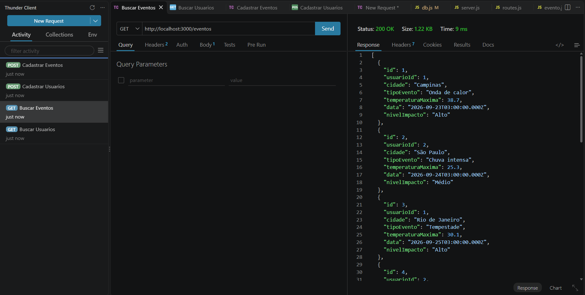
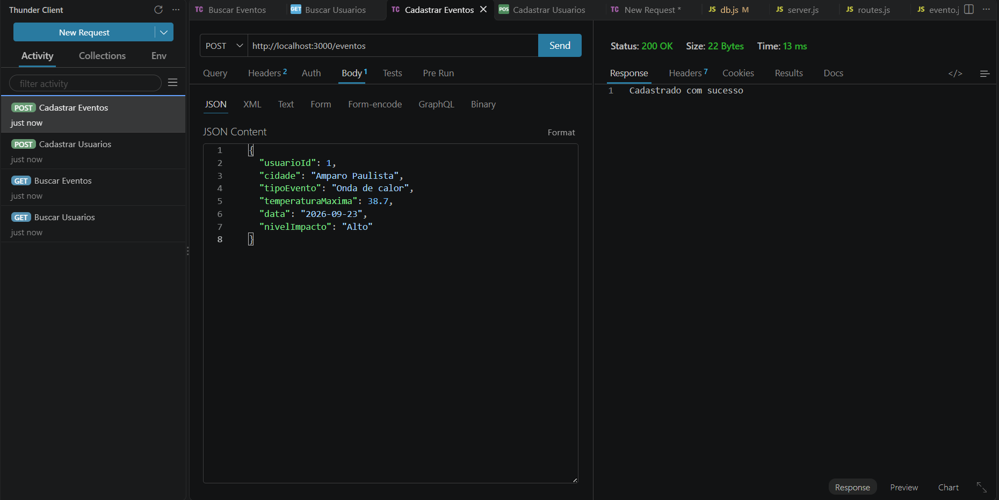
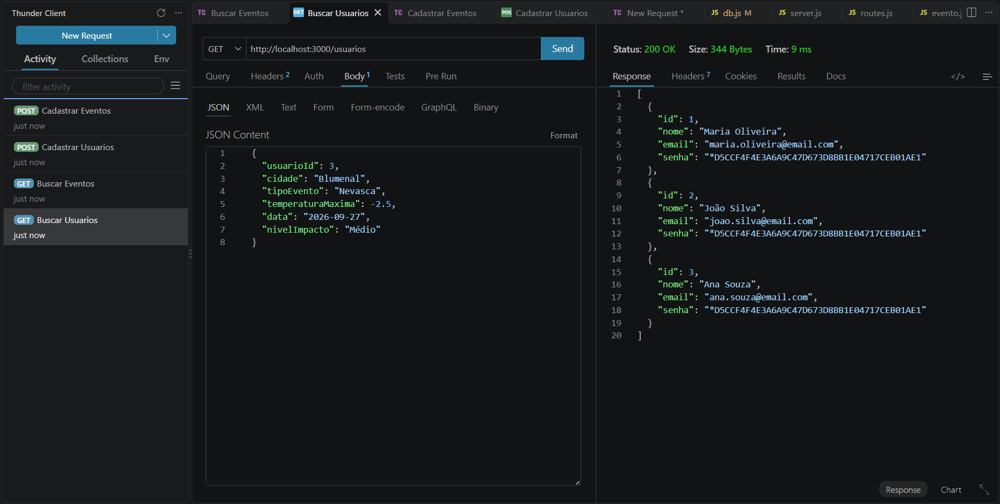
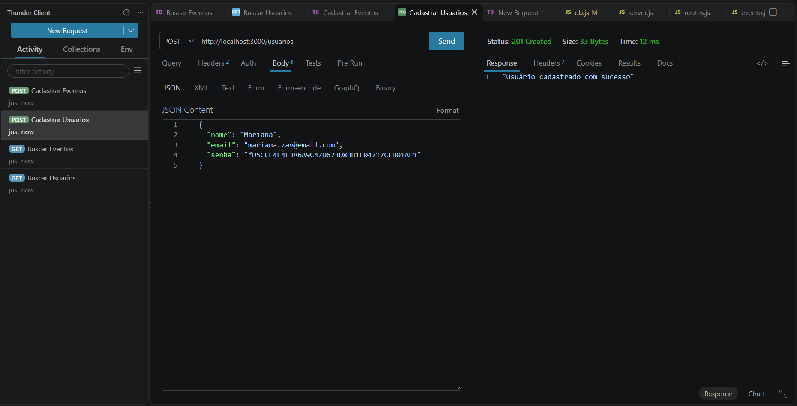

# 🌦️ API de Eventos Climáticos

Projeto desenvolvido na disciplina de Programação Back-End (PBE), com foco na construção e no teste de uma API para gerenciamento de eventos climáticos.

## 📖 Sobre o projeto

Esta aplicação tem como objetivo praticar os conceitos de **API REST**, integração com banco de dados e operações **CRUD** (*Create, Read, Update e Delete*) no contexto de eventos climáticos. Os testes das requisições HTTP são documentados com o **Thunder Client**, extensão do Visual Studio Code.

## 🛠️ Tecnologias utilizadas

- **JavaScript** — linguagem de programação.
- **Node.js** — ambiente de execução.
- **Express** — framework para criação da API.
- **MySQL** — banco de dados relacional.
- **CORS** — middleware para configuração de acesso entre origens.
- **Thunder Client** — ferramenta para testar requisições HTTP.
- **Visual Studio Code** — ambiente de desenvolvimento.

## 🚀 Como executar

### 1. Clonar o repositório

```bash
git clone https://github.com/miguelpignata/sesi_pbe1_aula09_eventos_climaticos_2026.git
```

### 2. Instalar as dependências

```bash
npm install
```

### 3. Configurar o banco de dados

Consulte os arquivos da pasta `db/`, prepare o banco MySQL e ajuste as configurações de conexão da aplicação conforme necessário.

### 4. Iniciar o servidor

```bash
npm run dev
```

## 🔄 Operações CRUD

| Operação | Método HTTP | Finalidade |
|---|---|---|
| Create | `POST` | Cadastrar um novo registro. |
| Read | `GET` | Consultar registros cadastrados. |
| Update | `PUT` ou `PATCH` | Atualizar um registro existente. |
| Delete | `DELETE` | Excluir um registro. |

## 🧪 Testes no Thunder Client

### Buscar Eventos 


### Cadastrar Eventos 


### Buscar Usuarios 


### Cadastrar Usuarios


## 📐 Diagramas do projeto

### MER DER Conceitual


### MER DER Lógico 


## 🎯 Objetivos de aprendizagem

- Compreender o funcionamento de uma API REST.
- Praticar as operações CRUD.
- Integrar Node.js, Express e MySQL.
- Testar e documentar requisições HTTP no Thunder Client.
- Representar a aplicação por meio de diagramas.
